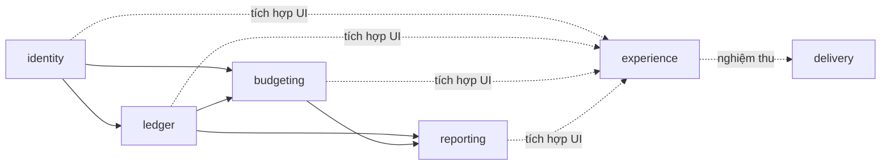

# Finora — phương án làm lại dự án

**Trạng thái: Đề xuất, chờ duyệt ranh giới module.** Ngày 28/10/2026.

Người dùng chọn hướng **cân bằng giao diện Gen Z, nghiệp vụ và chất lượng đồ án**. Đích đến là một ứng dụng web fullstack có thể chạy, demo và giải thích khi bảo vệ, giữ toàn bộ chức năng hiện có và dữ liệu hiện hữu.

Tài liệu này là capability map theo Phase 0 của `spec-driven-development`, chưa phải đặc tả module đã duyệt. Phần duyệt ở đây là trách nhiệm, chiều phụ thuộc và thứ tự xây dựng; các đặc tả chi tiết sẽ được viết theo từng module sau đó.

## Giả định đề xuất

- Giữ React + TypeScript, NestJS và PostgreSQL; stack hiện tại build/test được và đáp ứng bài toán. Chưa có bằng chứng cần đổi ngôn ngữ, framework hoặc database.
- Làm lại tổ chức mã nguồn, trải nghiệm và các phần nghiệp vụ có bằng chứng cần cải thiện. Các quy tắc tiền tệ đúng tiếp tục được bảo toàn bằng kiểm thử.
- Tiền VND, ngân sách tháng, múi giờ Việt Nam; dữ liệu tách theo tài khoản.
- Giao diện trẻ trung có chuyển động vui nhộn, đồng thời ưu tiên khả năng đọc số liệu và thao tác bàn phím.
- Dữ liệu, migration đã chạy và thông tin môi trường được giữ; không reset database.
- Bàn giao trên GitHub cùng tài liệu và PowerPoint đồng bộ. Chưa bao gồm mua dịch vụ, đăng ký tên miền hoặc triển khai có phí.

## Các module

| Module id    | Trách nhiệm / đầu ra                                                                                       | Phụ thuộc nghiệp vụ                                                                   |
| ------------ | ---------------------------------------------------------------------------------------------------------- | ------------------------------------------------------------------------------------- |
| `identity`   | Tài khoản, phiên, quyền sở hữu và trải nghiệm đăng nhập/đăng ký/đổi mật khẩu                               | —                                                                                     |
| `ledger`     | Ví, danh mục, sổ thu/chi/chuyển tiền; tìm kiếm, lọc, phân trang và CSV                                     | `identity`                                                                            |
| `budgeting`  | Lập ngân sách tự động/thủ công, xem trước, xác nhận và phiên bản; đối chiếu chi thực tế                    | `identity`, `ledger`                                                                  |
| `reporting`  | Tổng quan, dòng tiền, cơ cấu chi, tiến độ và cảnh báo ngân sách                                            | `ledger`, `budgeting`                                                                 |
| `experience` | Hệ thiết kế, khung điều hướng, trạng thái trang và chuyển động dùng chung; tích hợp các màn hình           | Không phụ thuộc nghiệp vụ ở phần dùng chung; màn hình sử dụng API của bốn module trên |
| `delivery`   | Kiểm thử xuyên suốt, CI, hướng dẫn chạy/vận hành, tài liệu phân tích thiết kế, kịch bản demo và PowerPoint | Kiểm chứng đầu ra của năm module trên; không được import ngược vào mã nghiệp vụ       |

`identity`, `ledger`, `budgeting`, `reporting` là ranh giới nghiệp vụ. `experience` và `delivery` là các nhóm công việc xuyên suốt, không phải service backend hay microservice mới. Module id được giữ ổn định xuyên suốt đặc tả và kế hoạch.

Mũi tên liền chỉ thứ tự cung cấp dữ liệu: module đích sử dụng hợp đồng module nguồn. Các service nghiệp vụ không gọi ngược UI. Không tạo chu trình phụ thuộc hay tách mạng giữa các module; backend vẫn là ứng dụng NestJS một khối có module rõ ràng.

## Thứ tự xây dựng đề xuất

1. **Mốc nền:** giữ bản hiện tại làm đối chứng; ghi tiêu chuẩn kiểm chứng và hợp đồng API đang có.
2. **Khung trải nghiệm:** token màu/chữ/khoảng cách, thành phần chung và điều hướng; kết hợp `identity` để có luồng đăng nhập hoàn chỉnh.
3. **`ledger`:** đi từng luồng hoàn chỉnh từ API đến UI: ví → danh mục → thu/chi → chuyển ví → lọc/xuất. Mỗi luồng giữ ứng dụng chạy được.
4. **`budgeting`:** kiểm chứng bộ phân bổ → xem trước → xác nhận → đối chiếu thực tế. Lịch sử phiên bản chỉ thêm UI/API nếu đặc tả module được duyệt bao gồm phần này.
5. **`reporting`:** tổng quan và báo cáo trên các hợp đồng sổ giao dịch/ngân sách đã ổn định; đo truy vấn và bundle trước khi tối ưu.
6. **`delivery`:** kiểm tra toàn bộ luồng, mobile/bàn phím/giảm chuyển động, CI và cập nhật tài liệu + PowerPoint. Kiểm thử và tài liệu từng phần được làm ngay trong các bước trên.

Không viết toàn bộ database, rồi toàn bộ API, rồi toàn bộ UI. Mỗi bước gồm các lát cắt chạy được và có điểm kiểm chứng.

## Tiêu chí đầu ra chung đề xuất

- Giữ đăng ký/đăng nhập, đổi mật khẩu, ví/danh mục, giao dịch, ngân sách, báo cáo và xuất CSV.
- Tổng tiền chính xác; chuyển ví bảo toàn tổng tài sản; dự kiến không cộng vào thực tế.
- Có trạng thái đang tải, chưa có dữ liệu, lỗi có thể thử lại và phiên hết hạn; không hiển thị nhầm lỗi mạng thành trạng thái đăng xuất.
- Đọc được tiếng Việt, số tiền và nhãn; sử dụng bàn phím, dialog và giảm chuyển động được.
- Kiểm tra 320/390/768/1024/1440px sau khi layout ổn định; trang không tràn ngang ngoài vùng bảng được chủ đích cho cuộn.
- Kiểm tra axe-core ở các màn hình và dialog chính, không còn lỗi mức serious/critical thuộc phạm vi kiểm tra. Kiểm tra tự động bổ sung cho kiểm tra bàn phím, không thay thế chứng nhận WCAG toàn diện.
- Build, typecheck và kiểm thử chạy được bằng lệnh trong repository. CI lặp lại được các kiểm tra đã cấu hình.
- Tài liệu và slide phản ánh đúng phần đã làm; không mô tả roadmap như chức năng đã có.

## Quyết định giữ phạm vi

Các mục AI, đồng bộ ngân hàng, nhiều tiền tệ, ứng dụng mobile native và quyền quản trị tài chính người khác nằm ngoài lần làm lại này, trừ khi được bổ sung thành yêu cầu cụ thể. “Tự động” hiện là phân bổ theo quy tắc, không phải AI.

## Hồ sơ để xem trước

- [Báo cáo rà soát có bằng chứng](docs/rebuild/ASSESSMENT.md)
- [Toàn bộ 25 skill và cách áp dụng](docs/rebuild/SKILLS.md)
- [Phương án giao diện và tổ chức dự án (PDF)](docs/rebuild/Finora-V2-Phuong-an.pdf)

## Điểm duyệt

Duyệt hoặc điều chỉnh sáu nhóm công việc, chiều phụ thuộc, thứ tự xây dựng và phạm vi nêu trên. Theo skill đã được yêu cầu, cần duyệt capability map trước khi viết đặc tả từng module và thay mã nguồn ứng dụng. Việc chọn hướng cân bằng đã được ghi nhận; nó chưa phải duyệt ranh giới module khi tài liệu này chưa tồn tại.
