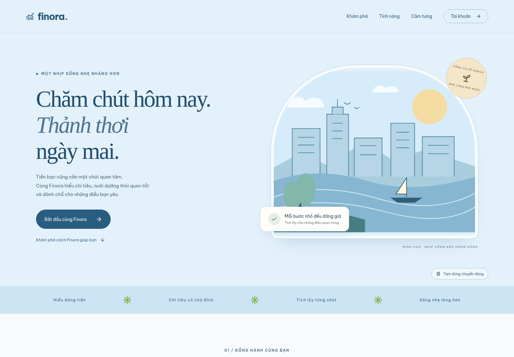
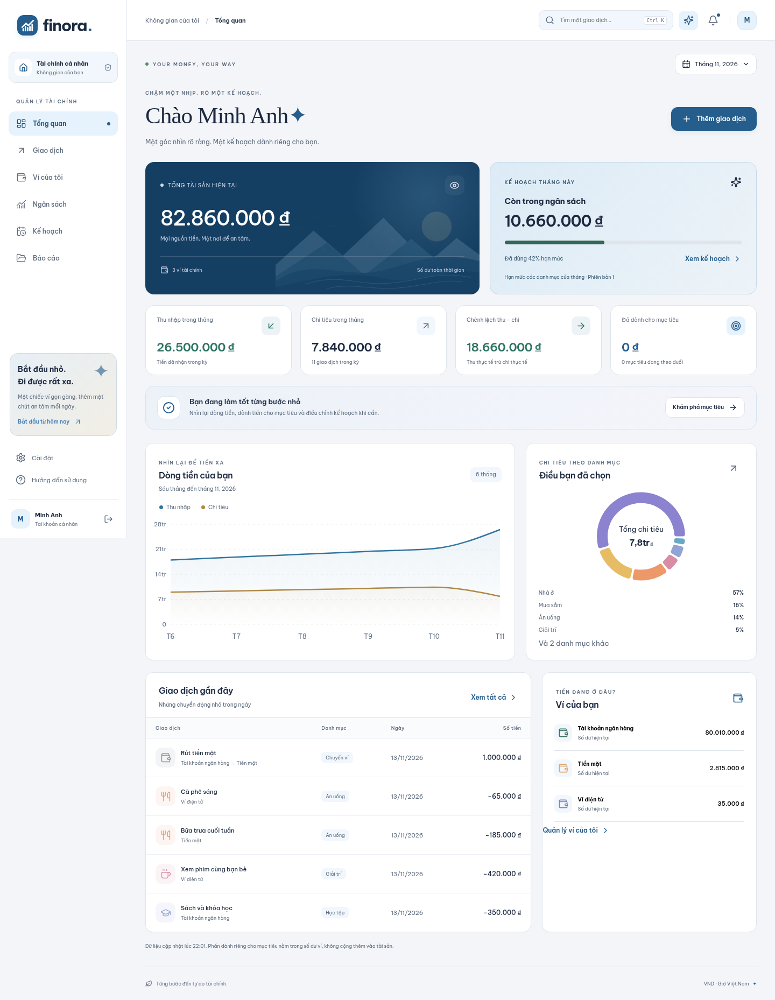

# Finora · Tài chính trong tầm tay

Ứng dụng fullstack quản lý tài chính cá nhân và lập ngân sách tự động, giao diện tiếng Việt, tiền VND, báo cáo theo múi giờ Việt Nam.

**Frontend:** React 19, TypeScript, Vite, CSS theo token, Motion, Recharts. **Backend:** NestJS 11, TypeScript. **Database:** PostgreSQL 17, Prisma 6.19 với bộ máy JavaScript và driver PostgreSQL.

Bản làm lại ngày **12/11/2026** đổi toàn bộ hệ thiết kế, hoàn thiện vòng đời kế hoạch và tổ chức NestJS thành các module. Giữ nguyên dữ liệu và migration. [Kết quả và giới hạn kiểm chứng](docs/rebuild/RENEWAL-2026-11.md) · [Hồ sơ quản lý đồ án](docs/PROJECT-MANAGEMENT.md).

Các mốc trước được giữ để đối chiếu: [Finora V2](docs/rebuild/RELEASE.md), [mở rộng 07/11](specs/002-financial-planning/verification.md).

Bản giao diện **Men lam — 13/11/2026**: xanh dương chủ đạo, trắng ngà và vàng cát; trang chào toàn màn hình, chữ cổ điển và minh họa sơn thủy. Thiết kế tham khảo các ảnh Gentlemen Barber Clubs người dùng gửi. [Đặc tả](specs/006-blue-atelier/spec.md) · [Kiểm chứng:40 API +19 browser đạt](specs/006-blue-atelier/verification.md).



## Xem trước giao diện

Ảnh chụp ứng dụng đang chạy với dữ liệu mẫu:



[Xem giao diện trên điện thoại](docs/images/mobile.png)

## Chức năng đã có

- Đăng ký, đăng nhập, đăng xuất, đổi mật khẩu, tên hiển thị và thu hồi các phiên đăng nhập khác.
- Tạo, đổi tên và lưu trữ ví; số dư được tính từ sổ giao dịch.
- Tạo, đổi tên, lưu trữ danh mục thu/chi; giữ nguyên dữ liệu lịch sử.
- Thêm, sửa, xóa giao dịch thu, chi, chuyển ví; lọc tháng/loại/ví/danh mục, kết hợp tìm kiếm và thứ tự ngày. Bộ lọc ví bao gồm chuyển đến; CSV cùng điều kiện.
- Ngân sách tháng tự động theo chi bắt buộc, trọng số và tiết kiệm dự kiến; hoặc nhập hạn mức thủ công.
- Xem trước, xác nhận ngân sách; gợi ý ba tháng, lịch sử và đối chiếu thực tế. Dùng phiên bản cũ làm bản nháp rồi xem trước, tạo revision mới khi xác nhận.
- Quy tắc thu/chi hằng tháng: nháp, xác nhận/bỏ qua, tạm dừng/bật lại và ngày cuối tháng. Đổi quy tắc từ tháng tương lai trong một transaction; giữ nguyên nội dung nháp cũ.
- Mục tiêu có hạn, sửa thông tin, lưu trữ/khôi phục, phân bổ/rút tiền và lịch sử. Lưu trữ vẫn giữ phần tiền đã dành và cho phép rút; không tạo tiền hoặc cộng dự trù vào thực tế.
- Nhập CSV tối đa 50 KB/200 dòng: preview, lỗi từng dòng, bỏ trùng và xác nhận nguyên tử.
- Báo cáo so tháng trước bằng số tiền và tải PDF tiếng Việt. [PDF/CSV mẫu chỉ dùng dữ liệu demo](docs/examples/README.md).
- Khôi phục mật khẩu qua SMTP cấu hình được; token một lần/30 phút và thu hồi phiên. [Cách thử bằng Mailpit và vận hành](docs/OPERATIONS.md).
- Chống ghi trùng cho thao tác tạo ví/giao dịch/ngân sách/kế hoạch qua Idempotency-Key và khóa transaction.
- Dashboard, biểu đồ dòng tiền sáu tháng, báo cáo theo danh mục, cảnh báo từ 80% hạn mức và xuất CSV.
- Giao diện Men lam dùng nền xanh sương, sidebar trắng, thẻ tài sản xanh lam, điểm nhấn ngọc bích và vàng cát. Dashboard gợi ý bước tiếp theo từ dữ liệu thật. Motion, minh họa nổi, responsive, skip link và menu bàn phím.
- Lỗi mạng/máy chủ khi khởi tạo phiên có thông báo và nút thử lại; phân biệt với chưa đăng nhập.
- API có `X-Request-Id`, mã lỗi và log metadata an toàn; không log body/cookie/số tiền.
- Nút ✨ trên màn hình đăng nhập và thanh công cụ giúp giảm chuyển động; lựa chọn được lưu trên thiết bị. Tôn trọng cài đặt giảm chuyển động của hệ điều hành, bao gồm biểu đồ.
- Trải nghiệm dữ liệu mẫu riêng cho từng lần tạo phiên demo. Mặc định tắt khi chạy production.

## Chạy trên máy phát triển

Yêu cầu **Node.js từ 22.12**, npm và Docker có Docker Compose v2. Cổng PostgreSQL 5432 phải còn trống.

```bash
bash scripts/setup.sh
bash scripts/start.sh
```

Script thiết lập tạo `.env` và `apps/api/.env` từ file mẫu **chỉ khi chưa có**, cài đúng lockfile với lifecycle script tắt (`npm ci --ignore-scripts`), tạo Prisma Client bằng lệnh dự án đã kiểm soát, khởi động PostgreSQL và chạy migration. Script không tự sửa file môi trường đã có.

- Frontend phát triển: cổng **5173**.
- API: cổng **3001**, tiền tố `/api`.
- Kiểm tra sẵn sàng: `curl --fail http://127.0.0.1:5173/api/health`.

Mở giao diện tại cổng 5173 và chọn **Trải nghiệm với dữ liệu mẫu** để khám phá, hoặc đăng ký tài khoản mới để bắt đầu từ dữ liệu trống. Tài khoản demo dùng thông tin đăng nhập ngẫu nhiên: phiên cookie cho phép tải lại trang, nhưng sau khi đăng xuất không có mật khẩu để đăng nhập lại. Hãy đăng ký tài khoản thật để lưu công việc lâu dài.

Các giá trị trong file `.env.example` chỉ phục vụ phát triển cục bộ. Khi dùng PostgreSQL khác, cập nhật `DATABASE_URL` trong `apps/api/.env`. Mật khẩu database trong `.env` gốc và URL kết nối API phải khớp nhau; thay đổi biến Docker không tự đổi mật khẩu của volume đã khởi tạo.

## Các lệnh hữu ích

```bash
npm run dev          # Chạy API và frontend cùng lúc
npm run typecheck    # Kiểm tra TypeScript
npm run check:fast   # Typecheck và kiểm tra định dạng
npm run format:check # Kiểm tra định dạng không sửa file
npm test             # Unit test + integration test với PostgreSQL thật
npm run build        # Build cả API và frontend
npm run db:generate  # Tạo lại Prisma Client sau khi sửa schema
npm run db:migrate   # Áp dụng migration SQL chưa chạy
npm run format       # Định dạng mã nguồn
```

Integration test tự mở API ở cổng ngẫu nhiên, tạo tài khoản riêng và dọn dữ liệu của chính nó sau khi chạy. Database phải được khởi động và migration trước đó.

Kiểm thử trình duyệt:

```bash
npx playwright install chromium
npm run test:e2e
```

Nếu môi trường đã có Chromium, không cần tải trình duyệt mới:

```bash
CHROMIUM_EXECUTABLE_PATH=/usr/bin/chromium npm run test:e2e
```

Playwright tự khởi động ứng dụng nếu chưa chạy. Các luồng kiểm thử bao gồm tài khoản demo, CRUD giao dịch, áp dụng ngân sách, tải CSV, giao diện điện thoại, đăng ký mới, tạo ví, ngân sách thủ công đổi tên danh mục và lưu tùy chọn giảm chuyển động. Kiểm tra bổ sung dùng axe-core cho đăng nhập/đăng ký, các trang chính và dialog giao dịch/ngân sách/mật khẩu; kiểm tra 320/390/768/1024/1440px, focus menu và lỗi khởi tạo phiên. Đây là kiểm tra tự động trong phạm vi cụ thể, không phải chứng nhận WCAG toàn diện. Các tài khoản do E2E tạo được giữ lại trong database phát triển.

Ngày 12/11: **40 API/nghiệp vụ và 18 browser test** đạt. Có regression các tính năng cũ, lifecycle, thay định kỳ đồng thời, snapshot báo cáo khi có ghi đồng thời, phục hồi lỗi trang, đổi tháng, bộ lọc/CSV, axe và responsive. [Bằng chứng kỹ thuật](specs/005-application-modules/verification.md) · [UI](specs/003-experience-renewal/verification.md) · [nghiệp vụ](specs/004-planning-lifecycle/verification.md).

Workflow `.github/workflows/ci.yml` chạy typecheck, format, API test, build, audit và browser test. CI dùng PostgreSQL tạm trên runner, không cần thông tin production. Chưa tự cấu hình branch protection.

Tạo lại ảnh tài liệu với PostgreSQL đã chạy/migrate:

```bash
CHROMIUM_EXECUTABLE_PATH=/usr/bin/chromium node scripts/capture-screenshots.mjs
```

## Quy tắc tài chính

Số tiền qua API là **chuỗi số nguyên VND**, lưu bằng `BIGINT`. Không dùng số thực để phân bổ ngân sách. Số dư ban đầu không tính vào thu nhập; chuyển ví không tính vào thu/chi.

```text
Tiền linh hoạt = Thu nhập dự kiến − Chi bắt buộc − Tiết kiệm dự kiến
Phần linh hoạt mỗi danh mục = Tiền linh hoạt × Trọng số / Tổng trọng số
```

Phần dư làm tròn được phân bổ theo phần thập phân lớn nhất; nếu bằng nhau, dùng thứ tự danh mục. Tổng phân bổ tự động cộng tiết kiệm luôn bằng thu nhập dự kiến. Nếu thiếu nguồn tiền, hệ thống trả lỗi và không áp dụng kế hoạch. Phương án thủ công có thể để lại tiền chưa phân bổ.

Tiết kiệm dự kiến là **kế hoạch**, không phải số tiền đã tiết kiệm. Thu nhập dự kiến không cộng chồng lên thu nhập thực tế. Vượt ngân sách vẫn được ghi nhận vì giao dịch phản ánh thực tế. Ví có thể âm nếu dữ liệu được nhập thiếu hoặc chi vượt số dư; giao diện hiển thị cảnh báo.

## Migration và dữ liệu

`apps/api/prisma/schema.prisma` mô tả mô hình Prisma; migration SQL được lưu trong `apps/api/prisma/migrations`.

Dự án dùng runner SQL `apps/api/scripts/migrate.mjs` thay cho `prisma migrate deploy`. Runner chạy trong transaction, khóa chống chạy đồng thời và kiểm tra SHA-256 của migration đã áp dụng. **Không sửa migration đã chạy**; thêm thư mục migration mới khi thay đổi dữ liệu. Không trộn lịch sử `_finora_migrations` với Prisma Migrate.

Lý do: cấu hình Prisma 6.19 dùng engine JavaScript cho môi trường không tải được Rust engine; đường migrate qua adapter thử nghiệm gặp lỗi kiểu `name` của PostgreSQL. Runtime Prisma Client dùng JS engine đã được kiểm thử với PostgreSQL thật. Không tắt TLS, checksum hay kiểm tra integrity của package.

Docker lưu dữ liệu trong volume `finora_data`. Dừng database bằng `docker compose stop db`; **không dùng `docker compose down -v` nếu muốn giữ dữ liệu**. Không giả định volume Docker được giữ lại khi chuyển máy hoặc xuất bản môi trường cloud.

Sao lưu và kiểm tra khôi phục trên database riêng:

```bash
npm run db:backup -- .local/backups/finora-YYYYMMDD.dump
npm run db:restore-check -- .local/backups/finora-YYYYMMDD.dump
```

File sao lưu chứa dữ liệu riêng tư: không commit, không chia sẻ công khai. Với triển khai thực tế, cần sao lưu tự động và kiểm tra khôi phục định kỳ.

## Build và triển khai

```bash
npm run build
cd apps/api
NODE_ENV=production PORT=3001 npm start
```

Ở production, NestJS phục vụ frontend đã build cùng API trên một origin. Cần HTTPS reverse proxy giữ nguyên `Host`; cookie phiên có `Secure`, `HttpOnly`, `SameSite=Lax`. Không bật `ALLOW_DEMO` khi không chủ đích cho phép tạo tài khoản mẫu. PostgreSQL nên được quản lý bên ngoài hoặc có chính sách lưu trữ, sao lưu phù hợp; không dùng mật khẩu mẫu cho production.

Đã có Docker multi-stage/non-root, Compose production và Caddy HTTPS; [hướng dẫn triển khai, SMTP, backup và restore](docs/OPERATIONS.md). Người dùng chưa có hosting/tên miền/email nên chưa triển khai công khai hoặc gửi thư thật. Đã đo báo cáo trên 10.000 giao dịch nhân tạo, chưa kiểm thử tải đồng thời production. Chưa có email xác minh đăng ký, đồng bộ ngân hàng, nhiều tiền tệ, AI dự đoán hoặc quản trị viên. CSV giới hạn 10.000 giao dịch mỗi lần xuất và báo lỗi nếu vượt giới hạn, không cắt dữ liệu âm thầm.

## Tổ chức mã nguồn

- `apps/web/src/app`: khung điều hướng và dialog.
- `apps/web/src/features`: trang, form và hook của từng nghiệp vụ.
- `apps/web/src/shared`: HTTP client, kiểu, định dạng và biểu đồ.
- `apps/web/src/styles.css`: một hệ thiết kế dùng token; không còn lớp CSS override Studio.
- `apps/api/src/{identity,ledger,budgeting,planning,reporting,demo}`: controllers và Nest modules, nối tại `AppModule`; `infrastructure` cung cấp database/idempotency.
- Các provider nghiệp vụ ở `apps/api/src/{auth,wallets,transactions,budgets,planning,reports}.ts`; một ứng dụng NestJS, không microservice.
- `useFinanceData`, `useLedger`, `usePlanning`: dữ liệu theo tài khoản/tháng, hủy request cũ; ErrorBoundary cho trang và root; mọi feature page tải động.
- `apps/api/src/http.ts`: request ID và lỗi an toàn.

## Spec Kit cho quá trình phát triển

Đã tích hợp GitHub Spec Kit v1.3.0 cho Codex. Dùng `npm run spec-kit -- version`
trong terminal; trong chat Codex bắt đầu bằng `$speckit-specify` cho một thay đổi
mới. Công cụ cần uv và Python 3.11+, tách khỏi runtime web/API.

[Hướng dẫn tiếng Việt và các lệnh](docs/SPEC-KIT.md) ·
[Constitution Finora](.specify/memory/constitution.md) ·
[Đặc tả thay đổi](specs/README.md).

## Tài liệu dự án

- [PowerPoint báo cáo đồ án — 15 slide, PDF và ghi chú thuyết trình](docs/presentation/README.md)
- [Phân tích, thiết kế và kế hoạch phát triển](docs/DESIGN.md)
- [Hợp đồng API và quy tắc dữ liệu](docs/API.md)
- [Activity/sequence và mô hình mở rộng](docs/FINANCIAL-FLOWS.md)
- [Gantt, RACI, dự toán, risk register và UAT](docs/PROJECT-MANAGEMENT.md)
- [Ma trận yêu cầu–kiểm thử](docs/TRACEABILITY.md)
- [Vận hành HTTPS, email, backup/restore](docs/OPERATIONS.md)

Repository: [tunato2807-del/qlduanphammen](https://github.com/tunato2807-del/qlduanphammen).
