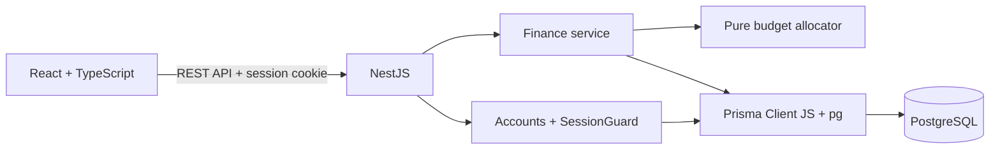
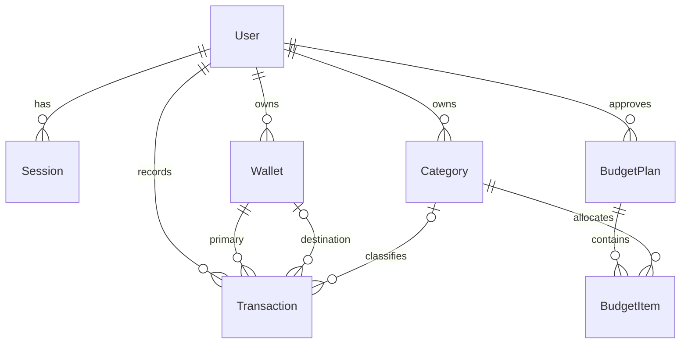

# Phân tích và thiết kế Finora

## Bài toán và phạm vi

Người dùng muốn tập hợp nguồn tiền, ghi nhận thu chi, hiểu dòng tiền và lập ngân sách theo ưu tiên cá nhân. Sản phẩm MVP là ứng dụng web cá nhân, một loại tiền VND, ngân sách theo tháng và múi giờ Asia/Ho_Chi_Minh. Người dùng quản lý dữ liệu của chính mình; không có vai trò quản trị xem tài chính người khác.

## Use case

| Nhóm      | Hành động                                                        |
| --------- | ---------------------------------------------------------------- |
| Tài khoản | Đăng ký, đăng nhập, đăng xuất, đổi mật khẩu                      |
| Ví        | Tạo, đổi tên, lưu trữ và bỏ lưu trữ                              |
| Danh mục  | Tạo, đổi tên, lưu trữ và bỏ lưu trữ                              |
| Giao dịch | Ghi thu/chi, chuyển ví, sửa, xóa, tìm kiếm và xuất dữ liệu       |
| Ngân sách | Xem trước tự động hoặc thủ công; xác nhận kế hoạch tháng         |
| Báo cáo   | Tổng thu/chi, số dư, sáu tháng dòng tiền, cơ cấu chi và cảnh báo |

## Kiến trúc triển khai

Môi trường phát triển dùng Vite proxy `/api` đến NestJS, tránh cấu hình CORS rộng. Bản production phục vụ frontend từ NestJS, cũng trên cùng một origin. Các nhóm controller được bảo vệ bằng session guard; dữ liệu được lọc theo `userId` trong service. Backend kiểm tra DTO một cách tường minh để cả môi trường `tsx` và bản TypeScript đã biên dịch có cùng hành vi.

## Mô hình dữ liệu

| Bảng        | Dữ liệu chính                                          | Ràng buộc                                                  |
| ----------- | ------------------------------------------------------ | ---------------------------------------------------------- |
| User        | UUID, email, tên, passwordHash                         | Email duy nhất; không trả hash qua API                     |
| Session     | SHA-256 của token, userId, expiresAt                   | Token thô chỉ nằm trong cookie HttpOnly                    |
| Wallet      | userId, tên, loại, số dư đầu, màu, archived            | Số dư đầu không âm; không xóa lịch sử                      |
| Category    | userId, tên, loại, biểu tượng, màu, archived           | Tên duy nhất theo người dùng và loại                       |
| Transaction | userId, loại, amount, ví, danh mục, ngày, ghi chú      | Số tiền dương; hình dạng thu/chi/chuyển ví hợp lệ          |
| BudgetPlan  | userId, tháng, revision, income, savings, mode, active | Một revision đang áp dụng cho mỗi người/tháng              |
| BudgetItem  | planId, categoryId, fixed, weight, limit               | Danh mục không trùng trong một phiên bản; giá trị không âm |

Số tiền là BIGINT. Ngày giao dịch là TIMESTAMPTZ. Chỉ mục phục vụ truy vấn theo chủ sở hữu, thời gian, ví và danh mục. Số dư được tính từ sổ giao dịch thay vì lưu hai bản số dư có thể lệch nhau.

## Luồng lập ngân sách

1. Người dùng nhập tháng, thu nhập dự kiến và tiết kiệm dự kiến.
2. Chọn cách tự động với khoản bắt buộc/trọng số, hoặc thủ công với hạn mức từng danh mục.
3. Backend xác minh danh mục thuộc tài khoản, đúng loại và chưa lưu trữ.
4. Tính phương án. Thiếu nguồn tiền hoặc đầu vào sai thì trả lỗi.
5. Xem trước không ghi database. Thay đổi đầu vào sẽ hủy phương án xem trước cũ.
6. Người dùng xác nhận. Backend tính lại từ đầu vào để không tin hạn mức do client gửi trong chế độ tự động.
7. Transaction database khóa theo người dùng/tháng, ngưng áp dụng phiên bản trước và tạo phiên bản mới.
8. Chi tiêu thực tế được tổng hợp từ giao dịch; không tự thay đổi hạn mức đã duyệt.

Phiên bản cũ được giữ trong database với thời điểm tạo; giao diện hiện hiển thị phiên bản đang áp dụng. Chưa có màn hình duyệt toàn bộ lịch sử phiên bản.

## Bảo mật và nhất quán

- Mật khẩu được băm bằng scrypt với salt ngẫu nhiên; so sánh bằng timing-safe comparison.
- Phiên có thời hạn bảy ngày. Đổi mật khẩu thu hồi các phiên khác, đăng xuất thu hồi phiên hiện tại.
- Backend kiểm tra quyền sở hữu cả tài nguyên chính và các ID tham chiếu; frontend không quyết định quyền truy cập.
- Kiểm tra Origin cho thao tác thay đổi dữ liệu, yêu cầu JSON, cookie SameSite, giới hạn tốc độ và Helmet.
- Dùng câu truy vấn có tham số; CSV vô hiệu hóa ký tự mở đầu công thức trong bảng tính.
- Ràng buộc PostgreSQL bổ sung cho số tiền, loại giao dịch và tính duy nhất của kế hoạch đang áp dụng.
- Runner migration có transaction, advisory lock và kiểm tra checksum; không tự reset database.

## Kế hoạch và nghiệm thu

| Gói công việc | Kết quả hiện có                          | Tiêu chí nghiệm thu                                                |
| ------------- | ---------------------------------------- | ------------------------------------------------------------------ |
| Nền tảng      | Monorepo, cấu hình môi trường, migration | Setup lặp lại được, dữ liệu lưu qua khởi động lại                  |
| Tài khoản     | Session và phân quyền                    | Không đọc/sửa tài chính người khác                                 |
| Sổ giao dịch  | Ví, danh mục, CRUD, chuyển tiền          | Thu/chi đúng; chuyển ví bảo toàn tổng tài sản                      |
| Ngân sách     | Tự động, thủ công, preview, revision     | Tổng đúng từng đồng, thiếu nguồn tiền báo lỗi                      |
| Giao diện     | Dashboard, mobile, biểu đồ, Motion       | Thao tác hoàn chỉnh, không tràn ngang trên điện thoại              |
| Kiểm thử      | Unit, HTTP integration, Playwright       | Thực thi quy tắc cốt lõi và luồng người dùng                       |
| Triển khai    | Production build và hướng dẫn            | Chạy bản build cùng API; triển khai công khai chờ cấu hình dịch vụ |

Rủi ro chính: dữ liệu người dùng nhập thiếu, giả định thu nhập không đạt thực tế, mở rộng phạm vi sang tích hợp ngân hàng, và lưu trữ database không bền vững khi đổi hạ tầng. Biện pháp hiện có là phân biệt kế hoạch với thực tế, cảnh báo số dư âm, giữ MVP tập trung và cung cấp hướng dẫn sao lưu.
