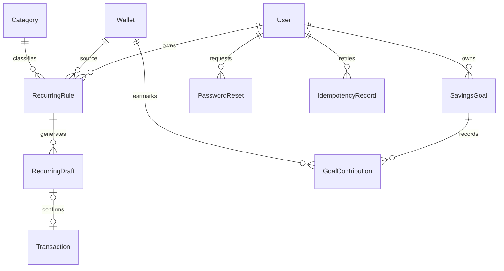
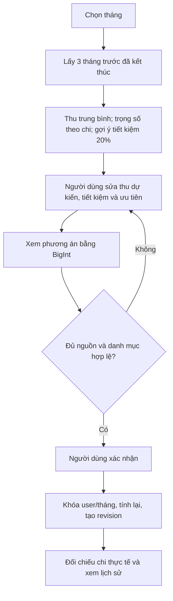
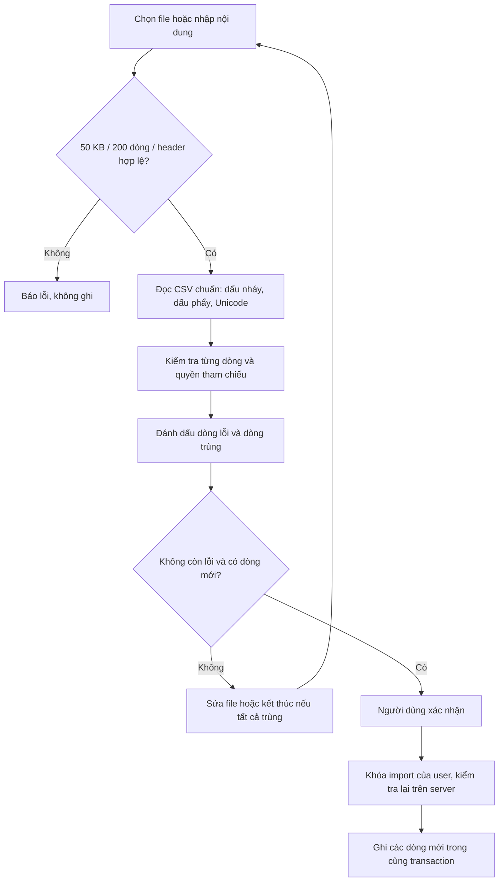
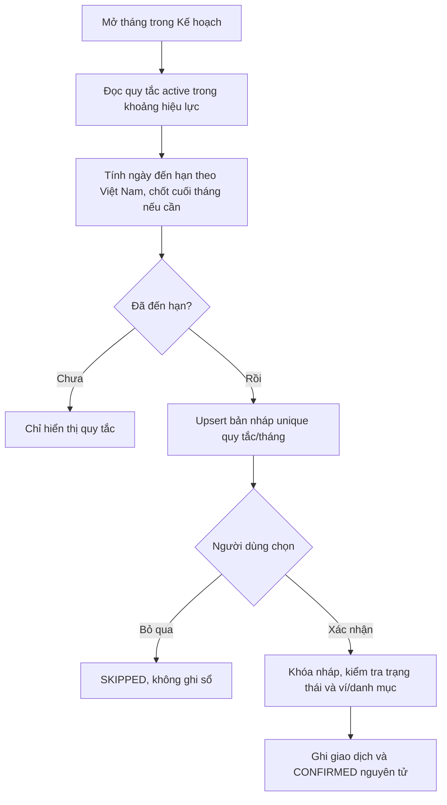
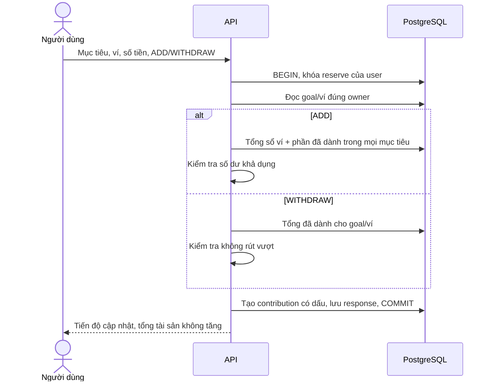

# Luồng nghiệp vụ và thiết kế mở rộng

07/11/2026 · Bổ sung cho [DESIGN.md](DESIGN.md), hợp đồng [API.md](API.md) và [đặc tả](../specs/002-financial-planning/spec.md).

## Dữ liệu và trạng thái



- `RecurringRule`: loại thu/chi, số tiền, ví/danh mục, ngày 1–31, tháng bắt đầu/kết thúc, active. Quy tắc chỉ thay trạng thái active trong phiên bản này; muốn đổi số tiền/lịch thì tạm dừng và tạo quy tắc mới, giữ dấu vết cũ.
- `RecurringDraft`: unique(rule, month), thời điểm đến hạn, `PENDING → CONFIRMED` hoặc `PENDING → SKIPPED`, không chuyển ngược. Liên kết transaction nullable khi giao dịch bị xóa, nhưng trạng thái vẫn CONFIRMED để không ghi lại tiền.
- `SavingsGoal`: số mục tiêu, hạn hoàn thành. `GoalContribution`: số tiền có dấu (dành thêm dương, rút âm), ví, thời điểm, ghi chú. Không phải ledger transaction; chỉ phân bổ tiền đã có. Không rút âm theo từng mục tiêu/ví. Dành thêm không vượt số dư ví trừ tổng đã dành tại thời điểm ghi; chi tiêu sau đó có thể làm thiếu phần dành riêng và UI cảnh báo. Chưa có chỉnh sửa hạn/mục tiêu hoặc đóng mục tiêu trên UI; lịch sử phân bổ vẫn được giữ.
- `PasswordReset`: id là SHA256 token, user, thời hạn, thời điểm tạo. Reset thành công xóa mọi token và phiên của user.
- `IdempotencyRecord`: unique(user,key), hash nội dung canonical + phạm vi thao tác, response JSON, createdAt. Không lưu cookie/token trong record. Key giữ trong DB không tự hết hạn ở phiên bản này để tránh ghi lặp do retry muộn; cần chính sách lưu trữ khi quy mô lớn.

Migration mới thêm 6 bảng (tổng 13 model), không sửa migration cũ. DB có check số tiền, loại, ngày, trạng thái, FK và unique; ownership nhiều bảng được kiểm tra tại service.

## Activity — lập ngân sách có căn cứ



Thu trung bình luôn chia 3, kể cả tháng bằng 0. Trung bình làm tròn xuống nguyên VND; gợi ý tiết kiệm bằng 20% trung bình làm tròn xuống. Không có thu thì trả 0 và thông báo, không đoán lương. Trọng số 0 cho danh mục không chi; UI cho trọng số khởi tạo nhỏ khi chưa có cơ cấu để người dùng tiếp tục chỉnh. Gợi ý không phải AI hay bảo đảm tài chính.

## Activity — nhập CSV



Fingerprint gồm thời điểm chuẩn ISO, loại, số tiền, ví nguồn/đích, danh mục và ghi chú trim. Hai khoản thực sự khác nhau nhưng có đủ bảy trường giống hệt sẽ bị xem là trùng; thay ghi chú/thời điểm để thể hiện khác biệt hoặc nhập thủ công. Không tự áp dụng số liệu preview từ client. CSV xuất có chống công thức; khi nhập lại đúng định dạng xuất Finora, hệ thống bỏ dấu nháy bảo vệ do bộ xuất thêm.

## Activity — khoản định kỳ



Không chạy cron gửi nhắc ngoài ứng dụng. Nháp được tạo khi mở tháng; khoản tương lai hiển thị trong quy tắc, không được hạch toán sớm. Chọn tháng trước để giải quyết khoản bỏ ngỏ, không tự bù hàng loạt vào sổ.

## Sequence — xác nhận và gửi lại

```mermaid
sequenceDiagram
  actor U as Người dùng
  participant W as React
  participant A as API
  participant D as PostgreSQL
  U->>W: Xác nhận ghi sổ
  W->>A: POST action + Idempotency-Key
  A->>D: BEGIN, khóa user/key
  alt Key đã dùng, cùng nội dung
    D-->>A: Response đã lưu
  else Yêu cầu mới
    A->>D: Khóa draft, đọc trạng thái + ownership
    A->>D: Tạo transaction; CONFIRMED; lưu response
  end
  A->>D: COMMIT
  A-->>W: Kết quả
  W-->>U: Đã ghi sổ
```

Cùng key nhưng khác nội dung/scope trả 409. Hai key khác nhau cùng nháp vẫn được bảo vệ bởi khóa nháp và trạng thái. Khi lỗi mạng/5xx, form giữ key của nội dung để thử lại; không tự lặp. Form đóng/mở lại mất key cục bộ nên người dùng cần kiểm tra sổ nếu không rõ kết quả; CSV và draft còn có bảo vệ trùng ở nghiệp vụ.

## Sequence — dành tiền cho mục tiêu



## Sequence — khôi phục mật khẩu

```mermaid
sequenceDiagram
  actor U as Người dùng
  participant A as API
  participant D as PostgreSQL
  participant M as SMTP
  U->>A: Yêu cầu theo email
  A-->>U: Thông báo chung
  A->>D: Tra tài khoản (tác vụ nền)
  opt Có tài khoản, chưa yêu cầu trong 1 phút
    A->>D: Lưu hash token, hết hạn 30 phút
    A->>M: Gửi liên kết trong fragment
    M-->>U: Email
  end
  U->>A: Token và mật khẩu mới
  A->>D: BEGIN, khóa token; kiểm tra hash/hạn
  A->>D: Đổi password hash, xóa token và mọi session
  A->>D: COMMIT
  A-->>U: Đăng nhập lại bằng mật khẩu mới
```
