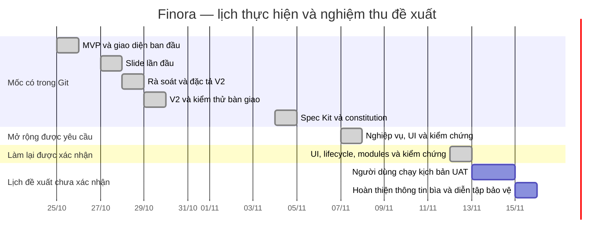

# Hồ sơ quản lý dự án Finora

Cập nhật 12/11/2026. Đề tài: xây dựng hệ thống quản lý tài chính cá nhân và lập ngân sách tự động. Hồ sơ dành cho báo cáo/bảo vệ; người dùng yêu cầu cân bằng trải nghiệm Gen Z, nghiệp vụ và chất lượng đồ án.

## Mục tiêu, phạm vi và bàn giao

Người dùng tự quản lý ví, sổ thu/chi/chuyển tiền; lập ngân sách có gợi ý từ lịch sử; xác nhận khoản định kỳ; dành tiền cho mục tiêu; nhập CSV và xem/xuất báo cáo. Số tiền nguyên VND, tháng theo Việt Nam, quyền truy cập riêng theo tài khoản.

Bàn giao: mã web/API, schema và migration, Spec Kit, kiểm thử/CI, ảnh giao diện, tài liệu phân tích thiết kế, kế hoạch quản lý, runbook, PowerPoint và ghi chú demo. Email/HTTPS có mã và cấu hình triển khai; chưa có dịch vụ/tên miền theo thông tin chủ dự án ngày 07/11. Không bao gồm đồng bộ ngân hàng, AI dự đoán, đa tiền tệ hoặc mua dịch vụ.

## WBS và trách nhiệm

| WBS | Công việc / đầu ra                               | Vai trò phụ trách     | Phụ thuộc | Bằng chứng                          |
| --- | ------------------------------------------------ | --------------------- | --------- | ----------------------------------- |
| 1   | Xác định yêu cầu, quy tắc tiền và phạm vi        | Phân tích/PM          | —         | CAPABILITY-MAP, specs/002           |
| 2   | Kiến trúc, dữ liệu, hợp đồng, UI                 | Phân tích + lập trình | 1         | DESIGN, API, schema, plan           |
| 3   | Nền tài khoản, sổ, ngân sách V2                  | Lập trình             | 2         | Commit 25–29/10, tests              |
| 4   | Lịch sử/gợi ý, định kỳ, mục tiêu, CSV, PDF       | Lập trình             | 3         | Mã và test mở rộng                  |
| 5   | Email recovery, Docker HTTPS, sao lưu/restore    | Lập trình/vận hành    | 3         | OPERATIONS, database.sh             |
| 6   | Regression, accessibility, responsive, benchmark | Kiểm thử              | 4, 5      | E2E, verification, performance.json |
| 7   | Báo cáo, slide, hướng dẫn và nghiệm thu          | PM + chủ đề tài       | 6         | Hồ sơ, biên bản UAT                 |

Vai trò có thể do cùng một sinh viên đảm nhiệm; chưa có danh sách thành viên/lớp/giảng viên nên không gán tên hoặc bịa phân công cá nhân.

## Gantt có ngày

Các mốc 25/10–04/11 đối chiếu được trong Git; 07/11 là ngày thực hiện gói mở rộng. Mốc UAT 08–10/11 của hồ sơ trước chưa có xác nhận thực hiện. Ngày 12/11 người dùng xác nhận làm lại toàn bộ UI/nghiệp vụ/kỹ thuật; lịch UAT bên dưới là đề xuất mới, vẫn chờ chủ đề tài.

Đường phụ thuộc quan trọng: yêu cầu → schema/API → luồng UI → kiểm thử → nghiệm thu. Không suy diễn số giờ thực tế từ ngày commit; Git chỉ cho biết thời điểm ghi nhận mã.

## RACI theo vai trò

R: thực hiện; A: chịu trách nhiệm quyết định cuối; C: tham vấn; I: được thông tin. Mỗi dòng có một A. “Chủ đề tài” là người chấp nhận sản phẩm; “giảng viên” chỉ là vai trò dự kiến, chưa ghi nhận phê duyệt thực tế.

| Hoạt động                      | Chủ đề tài | Phân tích/PM | Lập trình/vận hành | Kiểm thử | Giảng viên |
| ------------------------------ | ---------- | ------------ | ------------------ | -------- | ---------- |
| Chốt phạm vi và ưu tiên        | A          | R            | C                  | C        | C          |
| Thiết kế dữ liệu/quy tắc       | C          | A/R          | R                  | C        | I          |
| Triển khai tính năng           | I          | C            | A/R                | C        | I          |
| Kiểm thử và ghi bằng chứng     | I          | C            | C                  | A/R      | I          |
| Chọn hosting/tên miền, chi phí | A          | C            | R                  | I        | I          |
| Nghiệm thu và bảo vệ           | A/R        | R            | C                  | C        | C          |

## Dự toán tham khảo

Chưa có khoản mua dịch vụ nào được thực hiện. Đây là giả định để đưa vào đồ án, cần báo giá thực tế và quyết định của chủ dự án trước khi chi.

| Khoản                     | Giả định                                                    | Dự toán VND |
| ------------------------- | ----------------------------------------------------------- | ----------: |
| Phát triển và demo cục bộ | Công cụ nguồn mở, máy cá nhân sẵn có                        |           0 |
| VPS thử nghiệm            | 1 tháng × 150.000                                           |     150.000 |
| Tên miền                  | 1 năm × 300.000                                             |     300.000 |
| SMTP thử nghiệm           | Mailpit cục bộ; email thật chọn sau                         |           0 |
| HTTPS                     | Caddy + chứng chỉ ACME, không tính phí chứng chỉ            |           0 |
| Dự phòng                  | 10% của 450.000                                             |      45.000 |
| Tổng phương án có hosting | Chưa gồm thuế, backup ngoài máy chủ, phí email vượt hạn mức | **495.000** |

Ước lượng công sức cho nhóm tự làm một phiên bản tương đương: phân tích 8 giờ, thiết kế 10, backend 24, frontend 24, kiểm thử 12, tài liệu/demo 8 = 86 giờ. Đây là ước lượng kế hoạch, không phải timesheet. Nếu giả định 60.000 VND/giờ thì giá trị lao động quy đổi là 5.160.000 VND; không cộng thành tiền đã chi của sinh viên.

## Risk register

Thang xác suất/tác động 1 thấp–3 cao; điểm = tích, dùng để xếp ưu tiên chứ không phải xác suất thống kê.

| ID  | Rủi ro / dấu hiệu                           | Xác suất | Tác động | Chủ trì        | Giảm thiểu và phương án xử lý                                                      |
| --- | ------------------------------------------- | -------: | -------: | -------------- | ---------------------------------------------------------------------------------- |
| R01 | Sai số tiền, tính chuyển ví như thu nhập    |        2 |        3 | Lập trình + QA | BigInt, check SQL, test tổng và transfer; dừng release nếu sai                     |
| R02 | Gửi lặp tạo khoản chi/phân bổ hai lần       |        2 |        3 | Lập trình      | Idempotency + khóa transaction, test concurrent; không tự retry bằng key mới       |
| R03 | Truy cập chéo tài khoản                     |        2 |        3 | Lập trình + QA | Ownership mọi ID và test hai tài khoản                                             |
| R04 | Mất dữ liệu khi migrate/vận hành            |        2 |        3 | Vận hành       | Migration additive/checksum, backup trước deploy, restore DB riêng                 |
| R05 | SMTP/tên miền chưa có                       |        3 |        2 | Chủ đề tài     | Mailbox thử cục bộ; cấu hình/runbook sẵn; lên public sau khi có dịch vụ            |
| R06 | Quá hạn do mở rộng phạm vi                  |        2 |        2 | PM             | Spec rõ, checklist T01–10; không tự thêm ngân hàng/AI                              |
| R07 | Chuyển động cản thao tác/mobile tràn ngang  |        2 |        2 | UI + QA        | Reduced motion, bàn phím, axe và viewport 320–1440                                 |
| R08 | Sổ lớn làm báo cáo chậm                     |        2 |        2 | Backend        | SQL aggregate, index hiện có, benchmark dữ liệu riêng; đo lại trước mở rộng quy mô |
| R09 | Không giải thích được thuật toán khi bảo vệ |        2 |        2 | Chủ đề tài     | Demo BigInt/largest remainder, sơ đồ và kịch bản hỏi đáp                           |

## Kịch bản UAT cho người dùng

Đây là phiếu nghiệm thu thủ công chưa được người dùng thực hiện; kiểm thử tự động có bằng chứng riêng, không điền thay phản hồi người thật.

| Kịch bản                             | Kết quả mong đợi                                 | Người thử / ngày / kết quả                |
| ------------------------------------ | ------------------------------------------------ | ----------------------------------------- |
| Đăng ký, tạo ví và ghi một khoản chi | Số dư giảm đúng, báo cáo có giao dịch            | Chờ nghiệm thu                            |
| Gợi ý → sửa → xem trước → áp dụng    | Không ghi ngân sách trước xác nhận; giữ revision | Chờ nghiệm thu                            |
| Quy tắc ngày 31, tháng ngắn          | Nháp dùng cuối tháng; xác nhận chỉ một lần       | Chờ nghiệm thu                            |
| Mục tiêu → dành tiền → rút một phần  | Tài sản không tăng, lịch sử đúng                 | Chờ nghiệm thu                            |
| CSV có lỗi, sửa rồi nhập, nhập lại   | Lỗi không ghi sổ; file hợp lệ không nhân đôi     | Chờ nghiệm thu                            |
| PDF tiếng Việt và tháng trước        | Đúng số của tài khoản/tháng, đọc được dấu        | Chờ nghiệm thu                            |
| Quên mật khẩu qua mailbox cục bộ     | Link dùng một lần, phiên cũ hết hiệu lực         | Chờ cấu hình máy người dùng và nghiệm thu |
| Mobile, Tab/Escape, giảm chuyển động | Không kẹt focus, đọc và thao tác được            | Chờ nghiệm thu                            |

Sau nghiệm thu: ghi lỗi bằng request ID và bước tái hiện; không dán token, mật khẩu hoặc CSV thật lên issue công khai.

## Bổ sung nghiệm thu lần làm lại 12/11

Ba gói Spec Kit riêng quản lý UI (003), lifecycle (004), modules/snapshot (005); không ghi đè checklist 002 hoặc hồ sơ V2. Đã thực hiện sửa/lưu trữ/khôi phục mục tiêu, thay định kỳ tương lai, dùng revision làm draft, lọc ví/danh mục/chiều thời gian và tên hồ sơ. Truy vết và bằng chứng ở các feature tương ứng.

| Kịch bản UAT bổ sung                    | Kết quả mong đợi                                    | Người thử / ngày / kết quả |
| --------------------------------------- | --------------------------------------------------- | -------------------------- |
| Sửa, lưu trữ, rút và khôi phục mục tiêu | Giữ lịch sử, tài sản không tăng, archived không ADD | Chờ nghiệm thu             |
| Đổi số tiền định kỳ từ tháng tương lai  | Nháp cũ giữ số cũ, rule mới không ghi sớm           | Chờ nghiệm thu             |
| Lấy revision làm draft rồi xác nhận     | Có preview/cảnh báo category, tạo revision mới      | Chờ nghiệm thu             |
| Lọc ví nhận chuyển và xuất CSV          | Kết quả/CSV cùng điều kiện                          | Chờ nghiệm thu             |
| Đổi tháng, tab và phục hồi lỗi          | Không hiện nhầm dữ liệu kỳ cũ; tab giữ đúng         | Chờ nghiệm thu             |

Các kết quả tự động không được điền thay UAT này. Ước lượng chi phí và vai trò ở trên vẫn là giả định tham khảo, chưa phát sinh mua dịch vụ.
