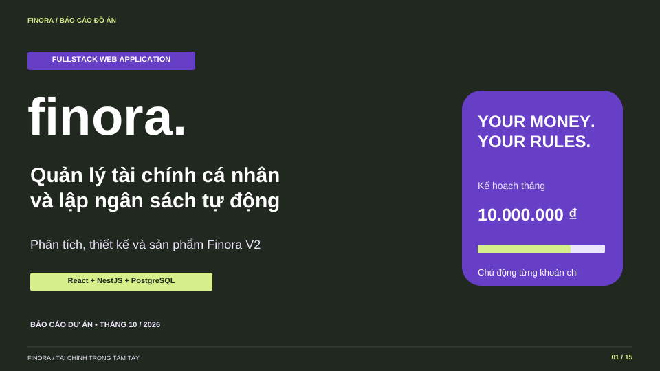

# Bài trình chiếu Finora V2

Cập nhật ngày 29/10/2026 theo bản làm lại V2 và ảnh giao diện đang chạy.

Báo cáo đồ án **quản lý tài chính cá nhân và lập ngân sách tự động**, 15 slide tiếng Việt, khổ 16:9. Thời lượng nội dung khoảng 12–14 phút; demo trực tiếp có thể thêm khoảng 2 phút.

- [Tải PowerPoint (.pptx)](Finora-Thuyet-trinh.pptx?raw=true) — chữ, bảng và sơ đồ có thể chỉnh sửa; chuyển slide bằng hiệu ứng Fade.
- [Xem bản PDF](Finora-Thuyet-trinh.pdf) — cùng nội dung và bố cục để đọc nhanh.
- [Ghi chú thuyết trình](Ghi-chu-thuyet-trinh.md) — cũng có trong phần Notes của từng slide PowerPoint.

## Nội dung

1. Giới thiệu đề tài.
2. Vấn đề và mục tiêu.
3. Phạm vi, yêu cầu chức năng và chất lượng.
4. Chức năng theo tác nhân.
5. Kiến trúc và công nghệ.
6. Mô hình dữ liệu rút gọn.
7. Quy tắc tài chính.
8. Luồng lập ngân sách.
9. Ví dụ phân bổ tự động và làm tròn.
10. Giao diện dashboard.
11. Mobile, phong cách và chuyển động.
12. Bảo vệ dữ liệu và kiểm thử.
13. Quản lý dự án theo đầu ra (WBS).
14. Hướng phát triển.
15. Kịch bản demo và thảo luận.

## Cá nhân hóa và trình chiếu

Mở file `.pptx` bằng Microsoft PowerPoint và bổ sung tên sinh viên/nhóm, lớp, giảng viên trên bìa nếu cần. Font dùng **Arial** để thuận tiện trình chiếu tiếng Việt. PDF giữ nguyên font và phù hợp khi máy trình chiếu hiển thị PowerPoint khác bố cục dự kiến.

Chọn Presenter View để đọc ghi chú. File không có macro hoặc âm thanh tự chạy. Ảnh ứng dụng sử dụng dữ liệu demo và được cắt khung để dễ nhìn; muốn xem chuyển động, chạy ứng dụng theo README dự án. Đường dẫn GitHub ở slide cuối mở mã nguồn, không phải website production.

## Căn cứ nội dung

Nội dung đối chiếu với [README dự án](../../README.md), [phân tích và thiết kế](../DESIGN.md), [schema](../../apps/api/prisma/schema.prisma), [thuật toán ngân sách](../../apps/api/src/budget.ts) và ảnh giao diện trong `docs/images`. Mốc MVP trước làm lại: `e83cbbd`; bản hiện tại theo [bàn giao V2](../rebuild/RELEASE.md).

Số 18 kiểm thử API/nghiệp vụ và 6 kiểm thử trình duyệt là kết quả đã chạy lại trong giai đoạn bàn giao V2 ngày 29/10/2026. Các mục triển khai công khai, email, tích hợp ngân hàng và AI được ghi rõ là hướng phát triển. Sơ đồ dữ liệu trên slide được rút gọn; xem tài liệu thiết kế để đọc các quan hệ đầy đủ.
