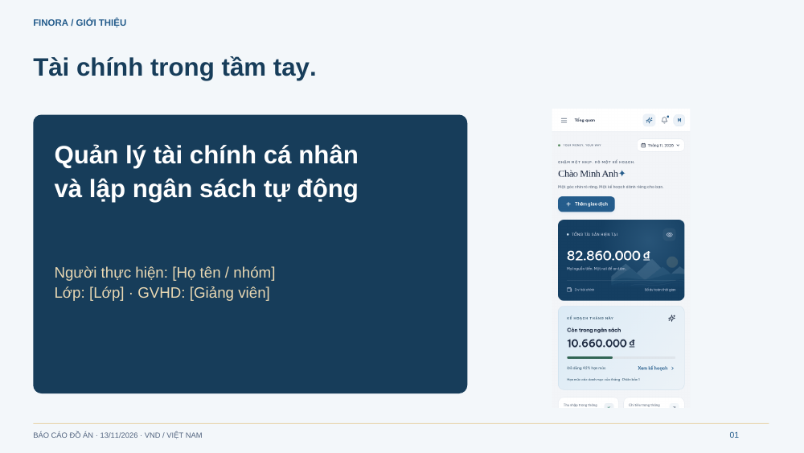

# Bài trình chiếu Finora

Cập nhật 07/11/2026 theo chức năng đã triển khai, ảnh ứng dụng và bằng chứng kiểm thử. 15 slide tiếng Việt, 16:9, khoảng 12–15 phút; có thể thêm 2 phút demo.



- [PowerPoint chỉnh sửa được](Finora-Thuyet-trinh.pptx?raw=true): chữ/sơ đồ là shape native, ảnh màn hình là dữ liệu demo, hiệu ứng Fade; có Notes.
- [Bản PDF để xem nhanh](Finora-Thuyet-trinh.pdf).
- [Ghi chú thuyết trình](Ghi-chu-thuyet-trinh.md).

Nội dung gồm vấn đề/phạm vi/tác nhân; kiến trúc và 13 model; thuật toán phân bổ BigInt; gợi ý/lịch sử ngân sách; định kỳ/mục tiêu; CSV/PDF; trải nghiệm; bảo vệ/vận hành; 34 API + 12 browser test; benchmark; Gantt/RACI/dự toán và kịch bản demo. Số đo cục bộ không được trình bày thành SLA production; kế hoạch UAT và dự toán được ghi là đề xuất. Email thật và public HTTPS chờ dịch vụ/tên miền, theo xác nhận của chủ dự án.

Bìa còn ô họ tên/nhóm, lớp và GVHD để điền thông tin thật. Font PowerPoint Arial; bản PDF nhúng Liberation Sans có giấy phép trong assets. Ảnh được crop trong bố cục slide để đọc dễ hơn, không thay số liệu ứng dụng. Khi demo chuyển động, chạy web theo README; file không có macro hoặc âm thanh tự chạy.

Tạo lại sau khi chạy script chụp ảnh:

```bash
python -m venv .local/presentation-venv
.local/presentation-venv/bin/pip install -r tools/presentation/requirements.txt
.local/presentation-venv/bin/python scripts/build-presentation.py
```

Script sinh cùng lúc `.pptx`, PDF và notes từ một bố cục. Ảnh bìa PNG có thể render từ trang 1 PDF bằng `pdftoppm`. Nguồn số liệu: [verification](../../specs/002-financial-planning/verification.md), [performance](../../specs/002-financial-planning/performance.json), [quản lý dự án](../PROJECT-MANAGEMENT.md), [ma trận truy vết](../TRACEABILITY.md). Không ghi phản hồi người dùng chưa được thu thập thành kết quả UAT.
