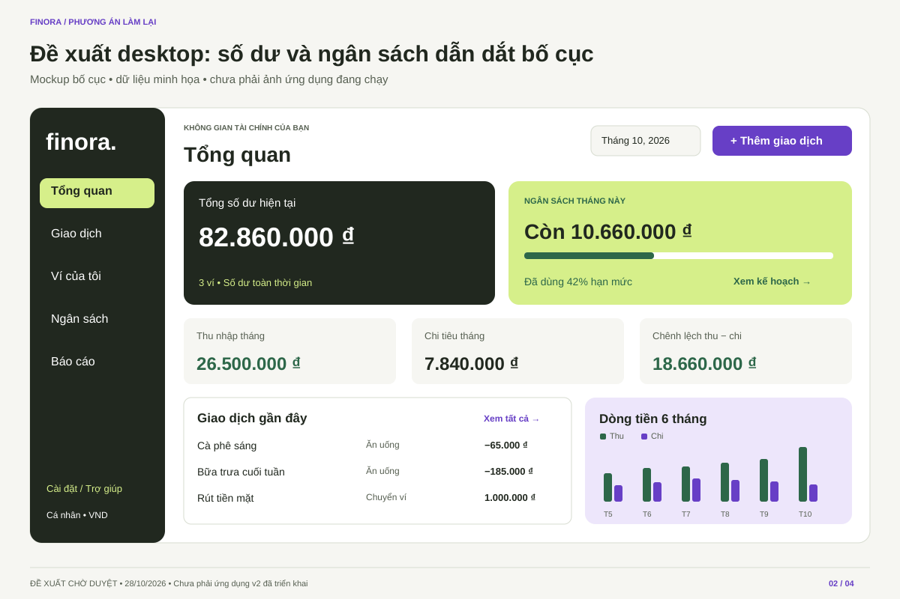
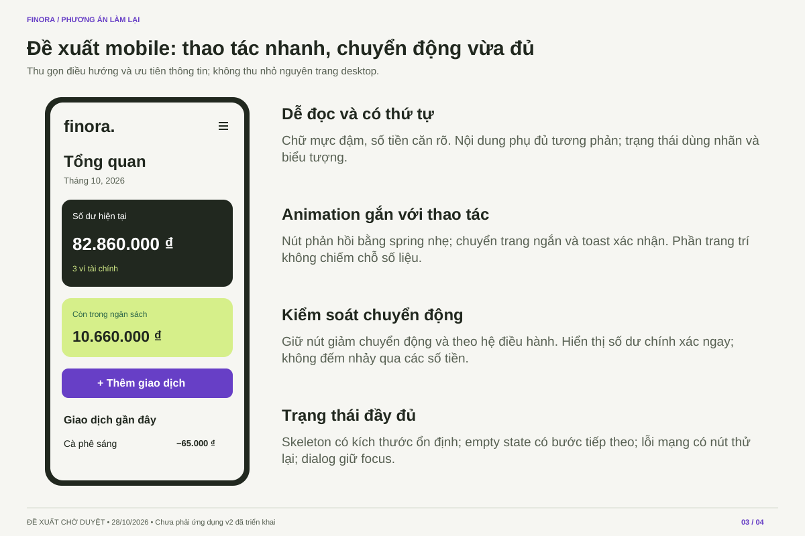

# Phương án làm lại Finora

**Đề xuất để duyệt, chưa phải phiên bản mới đã triển khai.** Hướng đã được người dùng chọn: cân bằng giao diện Gen Z, nghiệp vụ và chất lượng đồ án.

- [Xem phương án 4 trang (PDF)](Finora-V2-Phuong-an.pdf)
- [Duyệt nhóm chức năng, quan hệ và thứ tự xây dựng](../../CAPABILITY-MAP.md)
- [Đọc báo cáo rà soát và kết quả kiểm chứng](ASSESSMENT.md)
- [25 skill đã đọc và cách áp dụng](SKILLS.md)

## Giao diện desktop đề xuất

## Giao diện mobile đề xuất

Bản đầy đủ giải thích ưu tiên nghiệp vụ, bố cục và chuyển động. Các số tiền trong hình là minh họa. Mã nguồn ứng dụng hiện tại không thay đổi trong nhánh đề xuất này.

Theo Phase 0 của skill `spec-driven-development`, bước tiếp theo cần duyệt ranh giới module trước khi viết đặc tả module. Bài thuyết trình hiện tại vẫn mô tả MVP hiện tại; sẽ được cập nhật khi triển khai được duyệt và có kết quả thực tế.
